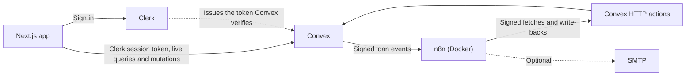
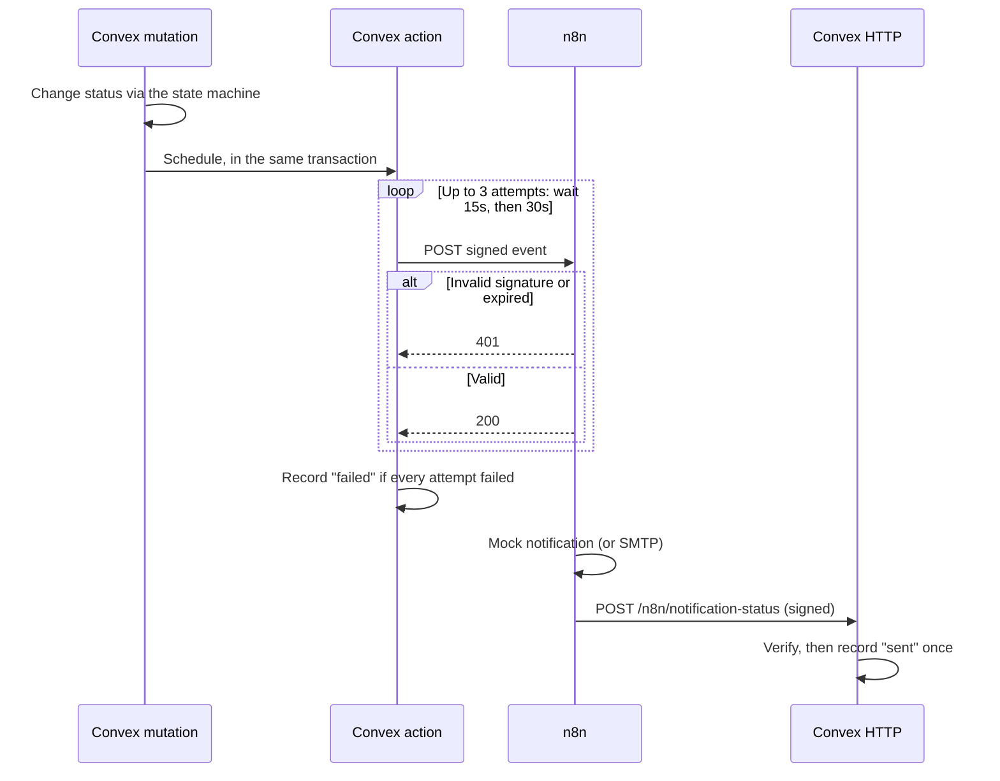
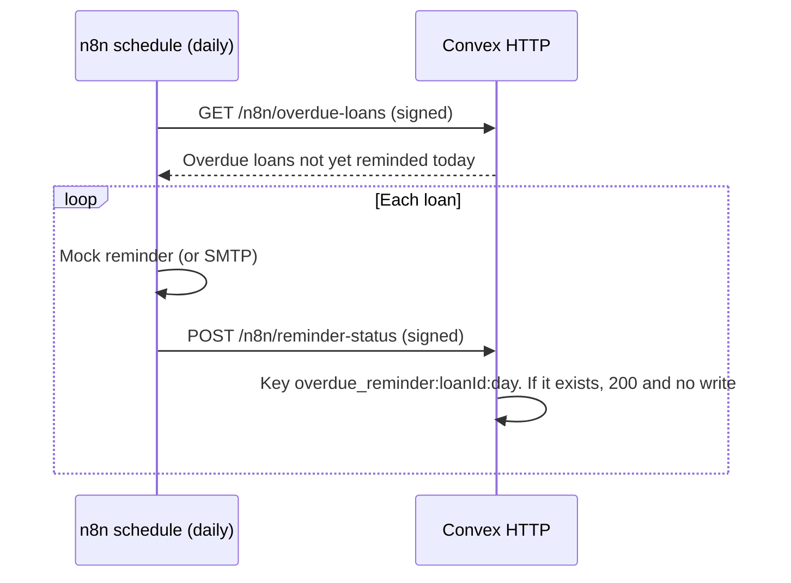

# LendLoop

> Borrow what you need. Lend what you don't.

## 1. What it is

LendLoop is a neighbourhood tool-lending board: neighbours list tools, request to borrow from each other, and get automated notifications and overdue reminders.
It is built with Next.js, Clerk and Convex, with the automation in self-hosted n8n.

| Public page | All tools | Incoming requests | Admin |
|---|---|---|---|
| _Screenshot placeholder_ | _Screenshot placeholder_ | _Screenshot placeholder_ | _Screenshot placeholder_ |

## 2. Local setup

You need Node 22.12 or newer and Docker. Commands run from the repo root. Generate each secret below with:

```sh
node -e "console.log(require('crypto').randomBytes(32).toString('hex'))"
```

### Install

```sh
npm install
```

### Clerk

1. Create an application at [dashboard.clerk.com](https://dashboard.clerk.com).
2. Open the [Convex integration](https://dashboard.clerk.com/apps/setup/convex) page and select **Activate Convex integration**. This replaces the hand-made `convex` JWT template older guides describe, though `ConvexProviderWithClerk` still supports one.
3. Copy the **Frontend API URL** it shows, such as `https://verb-noun-00.clerk.accounts.dev`.
4. Under **Sessions > Claims**, make sure these claims exist, and add any that are missing. Without `email`, account setup fails. Without `email_verified`, `ADMIN_EMAILS` grants nothing.

   ```json
   {
     "email": "{{user.primary_email_address}}",
     "email_verified": "{{user.email_verified}}",
     "given_name": "{{user.first_name}}"
   }
   ```

5. Copy the publishable and secret keys from **API keys**.

### Convex

Use a **local deployment** for development. A cloud deployment can't reach n8n on `localhost`, so outbound notifications would fail (see [Tradeoffs](#7-tradeoffs-and-what-id-do-with-more-time) for the tunnel alternative).

```sh
npx convex login
npx convex dev --once          # creates the project; choose any name
npx convex deployment select local
```

The first run may stop with an error about `CLERK_JWT_ISSUER_DOMAIN`. That is expected, and the next step sets it.

```sh
npx convex env set CLERK_JWT_ISSUER_DOMAIN https://verb-noun-00.clerk.accounts.dev
npx convex env set ADMIN_EMAILS you@example.com
npx convex env set LENDLOOP_WEBHOOK_SECRET <secret>
npx convex env set N8N_WEBHOOK_URL http://127.0.0.1:5678/webhook/lendloop-notification
npx convex dev                 # leave running
```

### Next.js

Copy `.env.example` to `.env.local` if it doesn't exist, keeping the two Convex values `npx convex dev` wrote, and add the Clerk keys. Then:

```sh
npm run dev                    # http://localhost:3000
```

### n8n

Copy `n8n/.env.example` to `n8n/.env`. Set `LENDLOOP_WEBHOOK_SECRET` to the same value as Convex, and `N8N_ENCRYPTION_KEY` to a new secret. Then start n8n, import, publish and restart:

```sh
docker compose -f n8n/docker-compose.yml up -d
docker compose -f n8n/docker-compose.yml exec -u node n8n n8n import:workflow --separate --input=/workflows
docker compose -f n8n/docker-compose.yml exec -u node n8n n8n publish:workflow --id=LendLoopErrors01
docker compose -f n8n/docker-compose.yml exec -u node n8n n8n publish:workflow --id=LendLoopNotify01
docker compose -f n8n/docker-compose.yml exec -u node n8n n8n publish:workflow --id=LendLoopOverdue1
docker compose -f n8n/docker-compose.yml restart n8n
```

Open <http://localhost:5678> and create the owner account.

**Credentials:** none are needed for the default mock notifications. To send real email, create an SMTP credential in n8n, attach it to the **Send email (optional)** node in each workflow, enable the node and publish again. The workflows ship without credentials on purpose.

**Error Workflow:** the CLI import keeps workflow ids, so both workflows are already linked to **LendLoop error handler**. If you import through the editor instead, ids change: set it under **Settings > Error workflow** in both workflows.

### Make yourself admin

Sign in with an address listed in `ADMIN_EMAILS`, verified in Clerk. `ADMIN_EMAILS` is only read when a user record is created. For a user who already exists, open the Convex dashboard, go to **Functions > users:promoteToAdmin**, and run it with `{ "email": "you@example.com" }`.

### Test it end to end

| Test | Do this | Expect |
|---|---|---|
| Notification | Request a tool as one user | A success under **Executions** in n8n, then "Lender notified" on the loan |
| Bad signature | `node scripts/send-test-event.mjs --tampered` | `n8n responded with 401` |
| Overdue reminder | In the Convex dashboard, set an approved loan's `endDate` to a past date. Open **LendLoop overdue reminders** and select **Execute workflow** | "Reminder sent" on the loan |
| No duplicates | Execute the workflow again | No new entry |
| Failure reporting | `node scripts/send-test-event.mjs` (a signed event for a loan that doesn't exist) | n8n answers 200. About 15 seconds later the failure appears under **Automation failures** on `/admin` |
| Checks | `npm run typecheck`, `npm run lint`, `npm test`, `npm run check:secrets` | All pass |

Mock notifications appear in `docker compose -f n8n/docker-compose.yml logs n8n`. Manual runs don't trigger the Error Workflow, which is why the failure test uses a real webhook request.

## 3. Environment variables

| Name | Where it lives | Purpose |
|---|---|---|
| `CONVEX_DEPLOYMENT` | `.env.local` (written by Convex) | The deployment the CLI targets |
| `NEXT_PUBLIC_CONVEX_URL` | `.env.local` (written by Convex) | The deployment the browser connects to |
| `NEXT_PUBLIC_CLERK_PUBLISHABLE_KEY` | `.env.local` | Clerk public key |
| `CLERK_SECRET_KEY` | `.env.local` | Clerk server key |
| `CLERK_JWT_ISSUER_DOMAIN` | Convex | Issuer of the session tokens Convex accepts |
| `ADMIN_EMAILS` | Convex | Comma-separated verified emails made admin on first sign-in |
| `LENDLOOP_WEBHOOK_SECRET` | Convex **and** `n8n/.env` | Shared HMAC secret, which must match on both sides |
| `N8N_WEBHOOK_URL` | Convex | Where Convex sends loan events |
| `N8N_ENCRYPTION_KEY` | `n8n/.env` | Encrypts credentials stored in n8n |
| `LENDLOOP_CONVEX_SITE_URL` | `n8n/.env` | Where n8n reaches the Convex HTTP actions |
| `TIMEZONE` | `n8n/.env` | Timezone for the daily schedule |

`n8n/docker-compose.yml` also sets `N8N_BLOCK_ENV_ACCESS_IN_NODE`, `NODE_FUNCTION_ALLOW_BUILTIN`, `N8N_RUNNERS_MODE`, `CODE_ENABLE_STDOUT` and the execution-pruning settings. None of them are secret.

## 4. Architecture



Convex holds all data and rules. The UI only displays what Convex allows, and n8n only ever sees what a signed payload contains.

### Workflow 1: request notification



### Workflow 2: overdue reminders



### Failure handling

Both workflows name **LendLoop error handler** as their Error Workflow. It logs the failure, removes email addresses from the text, and posts it to `POST /n8n/automation-failure`. Failures appear on the loan when one is known, and always on `/admin`.

### Where things are

| Path | Contents |
|---|---|
| `convex/lib/auth.ts` | `requireUser`, `requireAdmin`, `requireToolOwner`, `requireLoanParticipant` |
| `convex/lib/loanStateMachine.ts` | The allowed loan status transitions |
| `convex/lib/signing.ts` | HMAC signing and verification |
| `convex/automation.ts` | Outbound action, retries, event recording |
| `convex/http.ts` | Signed n8n endpoints |
| `n8n/workflows/` | The three workflows |

## 5. Security decisions

**RBAC in Convex.** Every public function reads the caller's identity through `convex/lib/auth.ts` before doing anything else. The only exception is `tools.listPublic`, which is public by design. Identity comes from the verified token and no function accepts a user id for the caller. The role comes from the `users` table, so a `role` claim in a token is ignored. Anything only n8n or the scheduler should call is internal. Hiding a button in the UI is only a convenience.

**Admin bootstrap.** `ADMIN_EMAILS` only applies to a verified address, otherwise someone could claim an admin's email. It is checked only at record creation, so editing it later can't change an existing role.

**HMAC and replay window.** Requests are signed as `HMAC-SHA256(secret, "${timestamp}.${rawBody}")`. Signing the timestamp means an old request can't be given a new one. Requests more than 5 minutes from the current time, in either direction, are rejected. Signatures are compared in constant time (`crypto.subtle.verify` in Convex, `crypto.timingSafeEqual` in n8n). A missing secret rejects everything, and every signature failure gets the same 401, so a failed attempt reveals nothing.

**Idempotency.** The server builds keys from trusted values, so a caller can't choose one:

| Event | Key |
|---|---|
| Notification | `request_notification:${loanId}:${status}` (a loan reaches each status once) |
| Reminder | `overdue_reminder:${loanId}:${YYYY-MM-DD}` |
| Workflow failure | `automation_failure:${executionId}` |
| A failed send | The key above plus `:failed`, so it can't block a later success |

Convex has no unique indexes. A check on the index followed by an insert is safe because mutations are serializable: if two run at once, one retries and sees the other's row. The same property stops two overlapping approvals both succeeding.

**Secret handling.** Secrets live only in environment variables and n8n credentials, and only `.env.example` files are committed. `npm run check:secrets`, which also runs in the tests, fails if exported workflow JSON contains anything secret-looking or an attached credential.

**n8n `$env` tradeoff.** Code nodes read the HMAC secret from `$env`, which needs `N8N_BLOCK_ENV_ACCESS_IN_NODE=false` (n8n 2.x blocks it by default) and `NODE_FUNCTION_ALLOW_BUILTIN=crypto`. The cost is that anyone who can edit workflows can read every environment variable in the container. That is acceptable for a single-owner local instance, because n8n's credential system can't sign a request over a raw body with a timestamp. `PRODUCTION.md` covers how to reduce this.

## 6. Data-minimization decisions

| Surface | Exposes | Deliberately leaves out |
|---|---|---|
| `tools.listPublic` (signed out) | Name, category | Ids, owner, description, condition. Enforced by a `returns` validator, so an extra field makes the query fail rather than leak |
| `tools.list`, `tools.listMine` | Tool details, owner first name, Trusted Lender badge | Owner email |
| `loans.listMine`, `loans.listIncoming` | Dates, status, tool name, first names, activity labels | Emails, internal failure detail |
| `admin.listUsers` | First name, email, role | Clerk id. Email is included so admins can tell two people with the same name apart |
| Webhook to n8n | Event id and type, loan id, status, recipient's email and first name, tool name, dates | Description, the other party's details |
| `GET /n8n/overdue-loans` | Loan id, borrower's first name and email, tool name, due date | Lender, description |
| n8n container logs | Event id, first name, tool name | Email addresses |
| n8n execution history | The payloads above | Pruned after 7 days |

## 7. Tradeoffs and what I'd do with more time

- **UTC days.** "Today" is the UTC day everywhere. It keeps dates and idempotency keys consistent, but someone in the US on a late evening can't choose their local date as a start date. I'd store a timezone per neighbourhood.
- **Local Convex for development.** Cloud Convex can't reach `localhost`. To use a cloud deployment, expose n8n through a tunnel, set `N8N_WEBHOOK_URL` to the tunnel URL and `LENDLOOP_CONVEX_SITE_URL` to the `.convex.site` URL.
- **At-least-once delivery.** If n8n's response is lost, a retry can send a second notification. The app still records one event, and the stable `eventId` lets a real email provider dedupe.
- **A crashed action isn't retried.** Expected failures are caught and retried, but a hard crash mid-action loses that send.
- **Signature scope.** The signature covers the timestamp and body, not the method or path, so a captured request could be replayed to another endpoint within 5 minutes if its body passes validation there. I'd add both to the signed text.
- **One secret for both directions.** Compromise on one side exposes both. I'd use one per direction.
- **Replays inside the window.** A replayed write is harmless because of idempotency, but a replayed `GET /n8n/overdue-loans` returns data. I'd add a nonce store.
- **No pagination.** Lists stop at 100 items (200 for admin, 50 for failures), and tool lists read loans per tool. I'd add cursor pagination and store availability on the tool.
- **Soft delete only.** Deleted listings stay for loan history, and nothing purges personal data yet.
- **Duplicate pending requests.** A borrower can send overlapping pending requests for one tool, since only approved loans block dates. A lender declines the extras, and approving one blocks any overlapping request.
- **Availability in an open tab.** Convex re-runs a query when its data changes, not when the date does, so a tool can keep showing its old availability past midnight until something changes or the page reloads.
- **Tests.** Backend rules, signing and automation are well covered, but there are no browser tests. I'd add Playwright for the main flows.
